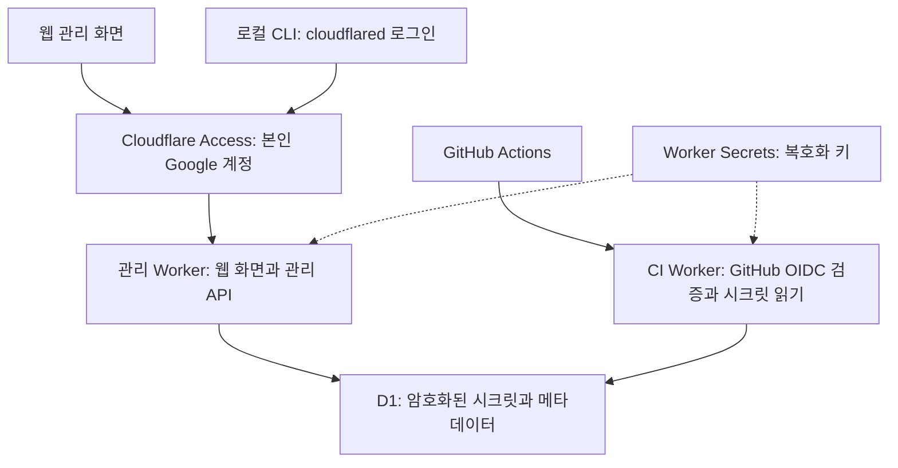

# 개인 시크릿 저장소 설계

개인 프로젝트의 시크릿과 PEM 키를 Cloudflare Workers에서 관리하고, 개발 PC와 GitHub Actions에서 실행하는 프로그램에 주입한다. 소스코드는 GitHub 공개 저장소로 관리하며, 운영 비용은 무료 서비스 한도 안으로 제한한다. 구현과 배포 및 성능 검증은 별도 작업이다.

사용자는 본인 한 명이다. Cloudflare 계정과 Worker 실행 환경은 신뢰하며 서버의 복호화를 허용한다. 공개 코드나 DB 암호문만으로 비밀값을 알아낼 수 없도록 설계한다. Cloudflare 계정이나 배포 권한, 로그인한 PC, 비밀값을 전달받은 프로그램이 침해되면 비밀값이 노출될 수 있다.

Cloudflare Workers 2개, D1 1개, Cloudflare Access, TypeScript CLI로 구성한다. CLI는 macOS와 Linux를 지원하며 Node.js와 cloudflared 설치를 전제로 한다. psm은 CLI의 가칭이다.



관리용과 CI용 주소를 분리한다. 관리 Worker는 Cloudflare Access로 보호하고, CI Worker는 GitHub 인증 토큰을 직접 검증한다. CI 인증을 위해 관리 API의 접근 제한을 풀지 않는다.

두 Worker는 DB와 복호화 키를 공유한다. CI의 읽기 전용 제한은 애플리케이션 코드가 적용하며, DB 권한 자체가 분리되는 구조는 아니다. 일반 D1 binding은 읽기와 쓰기 API를 제공한다. [D1 binding 설정](https://developers.cloudflare.com/workers/wrangler/configuration/#d1-databases)

첫 버전의 기능은 다음과 같다.

| 기능 | 동작 |
|---|---|
| 프로젝트와 환경 관리 | 프로젝트별로 dev, prod 등의 환경을 구분한다. |
| 일반 시크릿 | 등록, 수정, 삭제, 원문 보기, 복사를 제공한다. |
| PEM 시크릿 | 파일 업로드, 원문 보존, 복사, 다운로드를 제공한다. |
| 일괄 가져오기 | .env를 분석하고 중복 항목을 확인한 뒤 저장한다. |
| 변경 이력 | 현재 값을 포함한 최근 10개 버전을 유지한다. |
| 휴지통 | 삭제 후 7일 동안 복원할 수 있다. |
| CI 연결 | 저장소, 브랜치, 워크플로별 읽기 권한을 설정한다. |
| 백업과 복구 | 암호문 데이터 내보내기와 복구 절차를 제공한다. |

웹의 일반 목록에는 비밀값을 내려주지 않는다. 원문 보기, 복사, 다운로드를 요청할 때만 복호화한 값을 전달한다. .env 가져오기는 대상 프로젝트와 환경, 중복 키를 먼저 보여주고 덮어쓸 항목을 선택하게 한다. PEM 파일은 내용 전체를 하나의 시크릿으로 등록하며 줄바꿈을 보존한다.

공개 저장소에는 소스코드, 스키마, 비밀값 없는 설정 예시만 둔다. 실제 비밀값, 복호화 키, 인증 토큰은 소스나 빌드 산출물에 포함하지 않는다.

비밀값은 Worker에서 AES-256-GCM으로 암호화한 뒤 D1에 저장한다. 암호화마다 새로운 nonce를 사용하고 프로젝트, 환경, 시크릿, 버전 식별자를 인증 데이터에 포함한다. 복호화 키는 암호학적 난수로 생성해 Worker Secret에 보관하며 DB와 프런트엔드에는 넣지 않는다. 암호문에 key_id를 기록해 복호화 키 교체를 지원한다. Workers는 Secret 바인딩과 Web Crypto를 제공한다. [Workers Secrets](https://developers.cloudflare.com/workers/configuration/secrets/), [Web Crypto](https://developers.cloudflare.com/workers/runtime-apis/web-crypto/)

비밀값 응답에는 Cache-Control: no-store를 적용한다. 로그에는 비밀값, 인증 토큰, 요청 본문을 기록하지 않는다. 감사 기록은 주체, 작업, 대상 식별자, 결과, 시각을 보관하며 보관 기간은 30일로 한다.

접근 경로별 인증과 권한은 다음과 같다.

| 경로 | 인증 | 권한 |
|---|---|---|
| 웹 | Cloudflare Access에서 정확한 본인 이메일과 Google 로그인을 요구한다. | 관리 기능 |
| 로컬 CLI | cloudflared를 통해 브라우저로 로그인한다. | 본인 인증 후 요청한 시크릿 사용 |
| GitHub Actions | GitHub가 발급한 단기 OIDC 토큰을 검증한다. | 정책에 지정된 환경의 현재 값 읽기 |

로그인 세션은 1시간으로 설정한다. Google 로그인만 허용하도록 Access 정책을 구성한다. 이메일 허용과 Google 로그인 요구를 각각 적용해 허용 범위가 넓어지지 않도록 한다. 일반 Google 계정 연동에는 Google OAuth client 설정이 필요하다. [Google 연동](https://developers.cloudflare.com/cloudflare-one/integrations/identity-providers/google/), [Access 정책](https://developers.cloudflare.com/cloudflare-one/access-controls/policies/)

관리 Worker는 Access JWT의 서명, 발급자, 대상, 만료를 검증한다. 정적 웹 자산을 함께 제공하는 Worker에서는 ctx.access에 의존하지 않는다. production과 preview 주소 모두 관리 API 보호 범위에 포함한다. [Static Assets와 Access 제약](https://developers.cloudflare.com/workers/configuration/cloudflare-access/#ctxaccess-limitations)

로컬 CLI는 cloudflared의 공식 브라우저 로그인 흐름을 사용한다. cloudflared가 로컬 파일로 관리하는 인증 토큰은 프로젝트 시크릿 캐시와 구분한다. [CLI 인증 안내](https://developers.cloudflare.com/cloudflare-one/tutorials/cli/)

CI Worker는 GitHub 토큰의 서명, 발급자, 대상, 유효 시간을 검증한 뒤 다음 조건을 모두 확인한다.

- 저장소와 소유자의 변경되지 않는 숫자 ID
- 허용 브랜치와 워크플로 경로
- push 또는 workflow_dispatch 이벤트
- 대상 프로젝트와 환경에 연결된 활성 정책
- 정책에서 요구하는 경우 GitHub Environment

PR 실행에는 키를 제공하지 않으며 CI에는 시크릿 수정과 삭제 권한을 주지 않는다. 권한 정책은 요청마다 DB에서 확인해 비활성화된 정책으로 새 값을 가져올 수 없게 한다. 이미 프로그램에 전달한 값까지 회수할 수는 없다. GitHub Environment가 포함된 subject만으로 브랜치 제한이 충족됐다고 판단하지 않는다. [GitHub OIDC 명세](https://docs.github.com/en/actions/reference/security/oidc), [GitHub 실행 환경 보안](https://docs.github.com/en/actions/concepts/security/compromised-runners)

CLI의 기본 사용법은 다음과 같다.

```sh
psm login
psm run --project my-app --env dev -- npm run dev
```

프로젝트의 설정 파일에는 필요한 시크릿 이름과 전달 방식을 선언하며 값은 포함하지 않는다. CLI는 선언된 키가 누락됐는지 검사하고 해당 프로그램에 필요한 값만 가져온다.

일반 시크릿은 자식 프로세스의 환경변수로 전달한다. PEM은 실행별 임시 디렉터리에 파일로 만들고 GITHUB_PRIVATE_KEY_FILE 같은 변수로 경로를 전달한다. 디렉터리 권한은 0700, 파일 권한은 0600으로 제한한다.

정상 종료와 처리 가능한 종료 신호에서는 임시 파일을 삭제한다. 강제 종료로 남은 파일은 다음 CLI 실행에서 소유권과 실행 상태를 확인한 뒤 정리한다. 다른 실행이 사용 중인 파일은 유지한다. 사용자가 웹에서 직접 다운로드한 파일은 사용자가 보관과 삭제를 관리한다.

접속 실패, 권한 오류, 키 누락 시에는 자식 프로세스를 시작하지 않는다. 이전 시크릿을 대신 사용하는 로컬 캐시는 두지 않는다. CLI는 전달한 명령을 실행하고 종료 코드를 그대로 반환한다. 이미 키를 전달받아 실행 중인 프로그램은 저장소 장애가 발생해도 계속 동작한다.

데이터 모델은 다음 여섯 테이블을 중심으로 구성한다.

| 테이블 | 주요 데이터 |
|---|---|
| projects | 프로젝트 ID, 이름, slug |
| environments | 프로젝트 ID, 환경 이름 |
| secrets | 환경 ID, 키 이름, 일반 또는 파일 구분, 현재 버전, 삭제 시각 |
| secret_versions | 버전 ID, 암호문, nonce, key_id, 생성 시각 |
| ci_policies | 대상 환경, 저장소와 소유자 ID, 브랜치, 워크플로, 이벤트, 활성 여부 |
| audit_events | 주체, 작업, 대상 식별자, 결과, 시각 |

같은 환경 안에서는 키 이름이 중복되지 않게 한다. 수정에는 버전 검사를 적용해 동시 편집이 서로 덮어쓰지 않도록 한다. 값 수정과 버전 생성은 하나의 트랜잭션으로 처리한다. D1 batch에서 변경 건수 0은 SQL 오류가 아니므로 자동 롤백 조건으로 간주하지 않는다. [D1 batch](https://developers.cloudflare.com/d1/worker-api/d1-database/)

API는 관리용과 CI용을 다음처럼 나눈다. 아래 경로는 리소스 구조를 나타내며 HTTP 메서드와 요청 및 응답 스키마는 구현 시 구체화한다.

| 경로 | 용도 |
|---|---|
| /api/projects, /api/environments | 프로젝트와 환경 관리 |
| /api/secrets | 시크릿 목록, 등록, 수정, 삭제 |
| /api/secrets/:id/reveal | 원문 조회 |
| /api/secrets/:id/versions | 버전 목록과 복원 |
| /api/trash | 삭제 항목 조회와 복원 |
| /api/imports | 가져오기 미리보기와 적용 |
| /api/resolve | 로컬 CLI가 요청한 현재 값 조회 |
| /api/ci-policies | CI 접근 정책 관리 |
| /api/audit-events | 작업 이력 조회 |
| CI Worker의 /v1/resolve | 허용된 환경의 현재 값 조회 |

CI Worker에는 관리 라우트를 포함하지 않는다. 값 조회 API에는 요청한 키를 모두 반환하거나 전체 요청을 실패시키는 규칙을 적용한다.

복구는 D1의 최근 상태 복구와 별도 백업을 함께 사용한다. D1 Time Travel은 DB 전체 상태 복구이며 키별 변경 이력을 대신하지 않는다. 무료 보존 기간은 아래 무료 운영 한도 표를 따른다.

별도 백업에는 암호문과 복구에 필요한 메타데이터를 포함한다. 프로젝트명과 키 이름도 포함되므로 백업은 비공개로 보관한다. 복호화 키는 백업과 분리해 Cloudflare 밖에도 보관하며 과거 백업에 필요한 키도 유지한다. DB 백업만 있고 복호화 키를 잃은 경우 비밀값을 복구할 수 없다.

복구 데이터는 빈 DB에서 무결성과 복호화를 확인한 뒤 사용한다. 복구된 CI 정책은 비활성 상태로 시작해 재검토한다. 휴지통 만료나 DB 삭제는 이미 만든 백업 속 값을 삭제하지 않는다. 저장소에서 값을 복원하거나 삭제해도 해당 키를 발급한 서비스에서의 유효성은 바뀌지 않는다.

무료 운영은 현재 제공되는 한도 안에서 구성한다. 다음은 2026-10-14 공식 문서 확인 기준이며 계정의 다른 프로젝트와 공유하는 한도도 있다.

| 항목 | 무료 한도 또는 사용 방식 |
|---|---|
| Workers 요청 | 계정당 하루 100,000회 |
| Workers HTTP CPU | 요청당 10ms |
| D1 저장 공간 | DB당 500MB |
| D1 일일 처리 | 읽은 행 500만, 쓴 행 10만 |
| D1 Time Travel | 최근 7일 |
| 도메인 | 기본 workers.dev 주소 사용 |

[Workers 한도](https://developers.cloudflare.com/workers/platform/limits/), [D1 요금](https://developers.cloudflare.com/d1/platform/pricing/), [D1 Time Travel](https://developers.cloudflare.com/d1/reference/time-travel/), [workers.dev](https://developers.cloudflare.com/workers/configuration/routing/workers-dev/)

한도 초과 시 서비스가 실패할 수 있으며 유료 전환을 전제로 설계하지 않는다. 공개 CI 엔드포인트로 들어오는 원치 않는 요청도 가용성에 영향을 줄 수 있다. 도메인을 구매하지 않고 workers.dev 주소를 사용한다.

휴지통과 감사 기록은 예약 작업으로 조금씩 정리한다. Free Cron 작업에도 짧은 CPU 한도가 적용되므로 처리량을 제한하고 측정한다. JWT 검증과 암호화 처리가 무료 CPU 한도에 들어가는지는 실제 측정 전까지 미확정이다. [Cron 설정](https://developers.cloudflare.com/workers/configuration/cron-triggers/)

개발은 다음 순서로 진행한다.

1. 무료 환경에서 Access와 GitHub JWT 검증, 일반 키와 PEM 암복호화, D1 조회의 CPU 사용량을 측정한다.
2. 암호화 저장, 프로젝트와 환경, 수정 충돌 방지, 버전과 휴지통을 구현한다.
3. Google 로그인, 시크릿 관리 화면, .env와 PEM 가져오기를 구현한다.
4. CLI의 환경변수 주입, 임시 파일 권한과 정리, 오류와 종료 코드 처리를 구현한다.
5. CI 권한 정책, PR 거부, 백업 복구를 연결하고 전체 흐름을 검증한다.

출시 전에는 다음 조건을 확인한다.

- 권한 없는 요청과 잘못된 JWT를 거부한다.
- 변조된 암호문과 다른 시크릿에 옮겨진 암호문의 복호화가 실패한다.
- PR 실행과 허용 범위를 벗어난 GitHub 작업의 접근을 차단한다.
- 비활성화된 CI 정책으로 새 값을 가져올 수 없다.
- 비밀값과 인증 토큰이 로그와 공개 빌드 산출물에 포함되지 않는다.
- 수정 충돌이 데이터 손실이나 잘못된 버전 이력을 만들지 않는다.
- CLI는 누락된 키나 저장소 장애가 있으면 프로그램을 시작하지 않는다.
- PEM의 줄바꿈과 내용이 유지되고 임시 파일의 권한과 정리가 정책대로 동작한다.
- 빈 DB에서 백업을 실제 복구하고 복호화하며 CI 정책이 비활성 상태로 복원된다.
- 실제 무료 배포 환경에서 인증, 암호화, 조회, 예약 정리가 CPU와 사용량 한도를 충족한다.

무료 한도 검증에 실패하면 처리량과 구현을 조정한 뒤 다시 측정한다.
